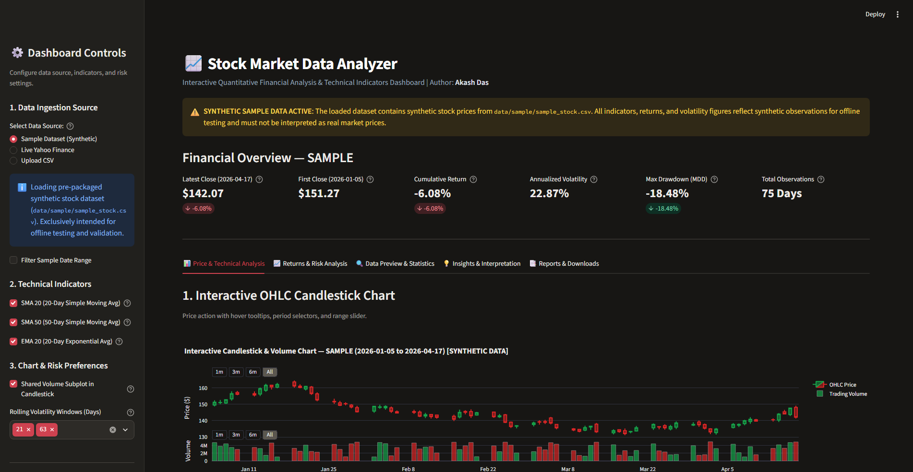
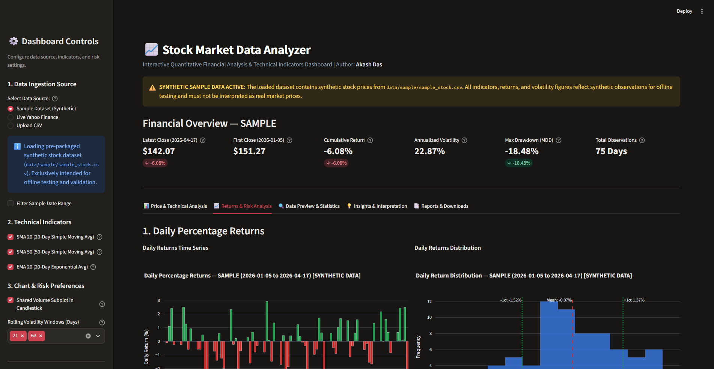
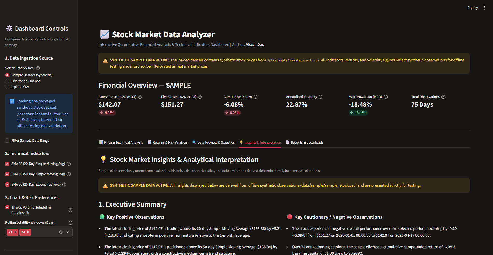
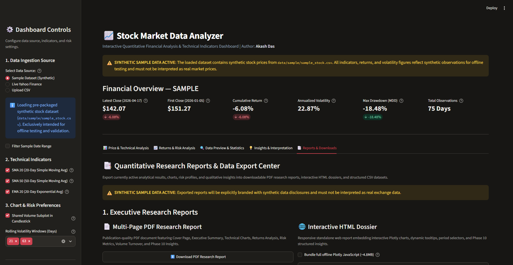

# Stock Market Data Analyzer

An institutional-grade quantitative financial analysis and time-series engineering platform. Features automated market data ingestion via Yahoo Finance, rigorous data validation, exploratory statistics, technical indicator computation, risk modeling, interactive Streamlit dashboards, structured evidence-based financial interpretation, and publication-ready multi-format report publishing (PDF, HTML, and CSV).

Author: Akash Das  
Repository: stock-market-data-analyzer  
License: MIT  

---

[](https://www.python.org/downloads/)
[](https://pandas.pydata.org/)
[](https://numpy.org/)
[](https://matplotlib.org/)
[](https://seaborn.pydata.org/)
[](https://plotly.com/)
[](https://streamlit.io/)
[](https://pypi.org/project/yfinance/)
[](https://www.reportlab.com/)
[](https://docs.pytest.org/)
[](LICENSE)

---

## Table of Contents

1. [Project Overview](#1-project-overview)
2. [Project Objectives](#2-project-objectives)
3. [Key Features](#3-key-features)
4. [Technological Stack](#4-technological-stack)
5. [System Architecture](#5-system-architecture)
6. [The Data Workflow](#6-the-data-workflow)
7. [Evidence-Based Financial Insights and Interpretation](#7-evidence-based-financial-insights-and-interpretation)
8. [Analytical and Mathematical Methodology](#8-analytical-and-mathematical-methodology)
9. [Dataset Architecture and Provenance](#9-dataset-architecture-and-provenance)
10. [Streamlit Interactive Dashboard](#10-streamlit-interactive-dashboard)
11. [Dashboard Screenshots and Visual Interface](#11-dashboard-screenshots-and-visual-interface)
12. [Multi-Format Report Generation](#12-multi-format-report-generation)
13. [Project Directory Structure](#13-project-directory-structure)
14. [Virtual Environment Setup](#14-virtual-environment-setup)
15. [Dependency Installations](#15-dependency-installations)
16. [Application Execution and Launch](#16-application-execution-and-launch)
17. [Running Tests and Quality Assurance](#17-running-tests-and-quality-assurance)
18. [Example End-to-End Workflow](#18-example-end-to-end-workflow)
19. [Privacy, Security, and Ethical Safeguards](#19-privacy-security-and-ethical-safeguards)
20. [Limitations and Regulatory Boundaries](#20-limitations-and-regulatory-boundaries)
21. [Future Improvements and Roadmap](#21-future-improvements-and-roadmap)
22. [Contribution Guidelines](#22-contribution-guidelines)
23. [License and Author Attribution](#23-license-and-author-attribution)

---

## 1. Project Overview

The Stock Market Data Analyzer is an institutional-grade quantitative equity research platform built in Python. It resolves the widespread challenge of data fragility, mathematical inconsistency, and opaque reporting commonly encountered in retail and educational financial tools.

Financial market datasets collected from public providers frequently suffer from data anomalies: non-synchronous calendar dates, missing bars, zero-volume sessions, erroneous price inversions, split distortions, and dividend misalignments. When quantitative indicators are computed on contaminated time-series data without rigorous validation, down-stream models produce unreliable signals.

This application provides a transparent, mathematically deterministic quantitative analysis pipeline. Every ingested dataset passes through strict invariant validation checks before mathematical indicators, risk metrics, and qualitative insights are generated. The system features a responsive Streamlit web console, dual visualization pipelines (static publication-quality Matplotlib figures and interactive web-based Plotly charts), automated qualitative financial heuristics, and publication-ready report compilers producing multi-page vector PDFs, interactive HTML dossiers, and standardized analytical CSV files.

---

## 2. Project Objectives

- Data Integrity Enforcement: Establish an invariant cleaning engine that enforces chronological monotonicity, non-negativity, and strict OHLC price boundary conditions across all data sources.
- Deterministic Mathematical Modeling: Calculate moving averages, geometric compounding returns, annualized volatility, and peak-to-trough drawdowns using exact, closed-form formulas without approximations.
- Objective Time-Series Interpretation: Implement a heuristic classification engine that translates quantitative metrics into plain-English observations without relying on speculative or unsupported claims such as participant attribution.
- Interactive Multi-Asset Research: Provide an intuitive, responsive Streamlit dashboard with dynamic parameter controls, high-contrast dark theme styling, and modular analytical tabs.
- Institutional Report Publishing: Automatically generate multi-page vector PDF research reports with dynamic two-pass canvas numbering, standalone responsive HTML reports, and machine-readable analytical datasets.
- Production-Grade Code Quality: Maintain a 100% test pass rate verified across 268 automated Pytest test cases, complete with type annotations, modular design patterns, and comprehensive architectural documentation.

---

## 3. Key Features

- Automated Market Data Retrieval: Fetch daily OHLCV bars directly from Yahoo Finance via yfinance for any standard equity ticker symbol with user-defined start and end dates.
- Flexible Data Ingestion Modes: Support three mutually exclusive ingestion workflows: Live Yahoo Finance queries, drag-and-drop CSV uploads, and a pre-packaged offline synthetic dataset.
- Invariant Data Cleaning: Automatically handle missing values, eliminate duplicate timestamps, verify positivity, and enforce OHLC consistency rules (High >= max(Open, Close) and Low <= min(Open, Close)).
- Exploratory Data Analysis: Generate descriptive statistics, interquartile price spreads, trading volume distributions, and pairwise Pearson correlation matrices.
- Technical Indicator Computations: Calculate 20-day Simple Moving Average (SMA 20), 50-day Simple Moving Average (SMA 50), and 20-day Exponential Moving Average (EMA 20) with crossover signal detection.
- Compounded Returns and Wealth Trajectory: Compute discrete daily percentage returns and geometrically compounded cumulative capital growth trajectories.
- Advanced Risk Analysis: Evaluate annualized volatility using the standard 252-session trading convention, multi-window rolling volatility (21-day and 63-day), and historical Maximum Drawdown (MDD) tracking.
- Dual Visualization Architecture: Produce publication-grade static figures through Matplotlib and Seaborn alongside interactive web-based charts with Plotly (hover tooltips, range sliders, period selectors).
- Modular Streamlit Web Interface: Five dedicated analytical tabs featuring live controls, responsive KPI cards, and custom CSS styling optimized for high-contrast accessibility.
- Evidence-Based Insight Engine: Generate deterministic qualitative findings categorized across trend momentum, risk regimes, and volume turnover anomalies, backed by explicit numeric evidence strings.
- Multi-Format Research Publishing: Export complete analytical packages including 10 to 11 page institutional vector PDFs, interactive HTML dossiers, and standardized machine-readable CSVs.

---

## 4. Technological Stack

| Component | Library / Tool | Pinned Version | Architectural Role and Responsibility |
| :--- | :--- | :---: | :--- |
| Runtime Environment | Python | 3.11.0 | Base language runtime, typing extensions, and standard libraries |
| Data Processing | Pandas | 3.1.1 | Vectorized DataFrame operations, time-series indexing, date parsing |
| Numerical Operations | NumPy | 2.4.6 | Vectorized mathematical operations, log returns, array transformations |
| Market Data Ingestion | yfinance | 1.8.0 | Historical equity price data retrieval from Yahoo Finance APIs |
| Static Visualizations | Matplotlib | 3.11.2 | High-resolution publication figures, vector charts, and in-memory image buffers |
| Statistical Plots | Seaborn | 0.13.2 | Correlation heatmaps, density distributions, and statistical aesthetics |
| Interactive Charts | Plotly | 7.1.0 | Interactive web candlesticks, moving average curves, and responsive HTML charts |
| Web Application | Streamlit | 1.67.0 | Reactive frontend interface, session state management, and control sidebar |
| Vector PDF Publishing | ReportLab | 5.1.2 | Multi-page PDF compilation, Flowable document layout, two-pass NumberedCanvas |
| PDF Verification | pypdf | 7.1.1 | PDF structure verification, page count validation, and metadata audits |
| Automated Testing | Pytest | 9.2.0 | Unit test runner, property tests, network isolation fixtures, integration suite |
| Environment Config | python-dotenv | 1.0.1 | Safe environment variable loading and local template management |

---

## 5. System Architecture

The Stock Market Data Analyzer follows a modular 4-tier separation of concerns:

```text
+-----------------------------------------------------------------------------------+
|                                PRESENTATION TIER                                  |
|   Streamlit Web Dashboard (app/dashboard.py)  |  CLI Entrypoint (main.py)         |
|   Sidebar Controls  |  KPI Metrics  |  Interactive Tabs  |  Report Downloaders    |
+-----------------------------------------------------------------------------------+
                                          |
                                          v
+-----------------------------------------------------------------------------------+
|                             REPORTING & VISUAL TIER                               |
|   StockReportGenerator  |  PDFReportGenerator  |  HTMLReportGenerator             |
|   CSVDataExporter       |  InteractiveChartGenerator  |  StaticChartGenerator     |
+-----------------------------------------------------------------------------------+
                                          |
                                          v
+-----------------------------------------------------------------------------------+
|                              CORE ANALYTICS ENGINE                                |
|   StockInsightAnalyzer (Heuristics)  |  IndicatorCalculator (SMA / EMA)          |
|   ReturnsCalculator (Compounding)    |  RiskAnalyzer (Volatility / Drawdown)     |
|   ExploratoryDataAnalyzer (Stats / Pearson Correlation Matrix)                    |
+-----------------------------------------------------------------------------------+
                                          |
                                          v
+-----------------------------------------------------------------------------------+
|                           INGESTION & DATA INTEGRITY TIER                         |
|   StockDataFetcher (Yahoo Finance)   |  StockDataLoader (CSV Ingestion)           |
|   StockDataCleaner (Chronological Sorting, Deduplication, OHLC Invariants)       |
+-----------------------------------------------------------------------------------+
```

Key Design Patterns:
- Immutability and Functional Purity: Analytical calculation functions do not mutate input DataFrames; every transformation returns a fresh DataFrame or copies.
- Pipeline Pattern: Raw inputs pass sequentially through validation, cleaning, transformation, calculation, heuristic classification, and rendering.
- Strategy Pattern: The ingestion engine isolates data retrieval strategies (Yahoo Finance, CSV, synthetic reference) behind a unified DataFrame contract.
- Two-Pass Canvas Compilation: ReportLab uses a custom NumberedCanvas class that records total page counts during the first layout pass and stamps accurate running headers and footers on the second pass.

---

## 6. The Data Workflow

The data lifecycle follows seven strictly validated sequential stages:

```text
[1. User Input / Ticker Selection]
       |
       v
[2. Ingestion Strategy] ---> Live yfinance API  |  Local CSV Upload  |  Offline Sample CSV
       |
       v
[3. Invariant Data Cleaning (StockDataCleaner)]
       |-- Validate chronological ascending order
       |-- Resolve timestamp duplicates deterministically
       |-- Verify positive price constraint (Open, High, Low, Close > 0)
       `-- Enforce OHLC consistency (High >= max(Open, Close), Low <= min(Open, Close))
       |
       v
[4. Quantitative Analytics]
       |-- Moving Averages: SMA 20, SMA 50, EMA 20
       |-- Daily Percentage Returns & Compounded Cumulative Growth Trajectory
       |-- Annualized Volatility (252-day convention) & Rolling Volatility (21d, 63d)
       `-- Historical Maximum Drawdown (Peak-to-Trough Underwater Curve)
       |
       v
[5. Structured Insight Evaluation (StockInsightAnalyzer)]
       |-- Trend Structure & Moving Average Alignment
       |-- Volatility Regime Classification
       |-- Volume Turnover Surge Analysis (Strictly without participant attribution)
       `-- Boundary Conditions & Non-Causation Disclaimers
       |
       v
[6. Dual Presentation & Visualization]
       |-- Streamlit Reactive Dashboard (Tabs 1 to 5)
       `-- Interactive Plotly Charts (Candlesticks, Indicators, Subplots)
       |
       v
[7. Multi-Format Publication Export]
       |-- Multi-Page Vector PDF Report (ReportLab)
       |-- Interactive HTML Dossier (Plotly CDN / Offline)
       `-- Standardized CSV Files (Cleaned OHLCV, Comprehensive Analysis, Insights)
```

---

## 7. Evidence-Based Financial Insights and Interpretation

The application includes a deterministic heuristic interpretation engine implemented in `StockInsightAnalyzer`. Rather than presenting raw figures in isolation, the system evaluates quantitative relationships and formats them into categorized, audit-ready observations:

### Trend and Momentum Evaluation
- Evaluates closing price position relative to short-term (SMA 20) and medium-term (SMA 50) baselines.
- Calculates moving average spread percentage: `Spread = ((SMA20 - SMA50) / SMA50) * 100`.
- Compares simple versus recency-weighted moving averages (SMA 20 vs EMA 20) to detect accelerating or decelerating trend momentum.

### Volatility Regime Classification
- Benchmarks current 21-day rolling volatility against the complete historical distribution of the asset.
- Categorizes volatility into four objective regimes:
  - Low Volatility: Below 25th historical percentile.
  - Moderate Volatility: Between 25th and 75th historical percentiles.
  - Elevated Volatility: Between 75th and 90th historical percentiles.
  - Extreme Volatility: Above 90th historical percentile.

### Trading Volume Turnover Interpretation
- Compares latest trading volume against the rolling 20-day volume moving average.
- Identifies turnover surges when volume exceeds 1.5 times the 20-day mean.
- Strict Compliance Guardrail: Aggregate OHLCV data cannot identify the identity or intent of market participants. The system explicitly describes surges as elevated market turnover and strictly avoids unsupported claims regarding institutional or retail flows.

### Structured Evidence Dictionaries
Every generated insight carries an immutable structured dictionary recording exact metric values, comparison thresholds, timestamp dates, and regulatory caveats, ensuring full auditability.

---

## 8. Analytical and Mathematical Methodology

### Invariant OHLC Relationships
Every bar must satisfy the physical realities of continuous double-auction exchange trading:
- Positive Prices: $Open > 0, High > 0, Low > 0, Close > 0$
- Non-Negative Volume: $Volume \ge 0$
- High Boundary: $High \ge \max(Open, Close)$
- Low Boundary: $Low \le \min(Open, Close)$

### Moving Average Calculations
- Simple Moving Average (SMA):
  $$SMA_t(N) = \frac{1}{N} \sum_{i=0}^{N-1} Close_{t-i}$$
- Exponential Moving Average (EMA):
  $$EMA_t(N) = \alpha \cdot Close_t + (1 - \alpha) \cdot EMA_{t-1}(N) \quad \text{where} \quad \alpha = \frac{2}{N + 1}$$

### Compounded Returns and Volatility
- Daily Return ($R_t$):
  $$R_t = \frac{Close_t - Close_{t-1}}{Close_{t-1}}$$
- Compounded Cumulative Return ($CR_t$):
  $$CR_t = \prod_{i=1}^t (1 + R_i) - 1$$
- Annualized Realized Volatility ($\sigma_{annual}$):
  $$\sigma_{annual} = \sigma_{daily} \times \sqrt{252} \quad \text{where} \quad \sigma_{daily} = \sqrt{\frac{1}{N-1} \sum_{i=1}^N (R_i - \bar{R})^2}$$

### Maximum Drawdown (MDD)
- Peak Price ($HighWaterMark_t$):
  $$HWM_t = \max_{\tau \le t} (Close_\tau)$$
- Drawdown ($DD_t$):
  $$DD_t = \frac{Close_t - HWM_t}{HWM_t}$$
- Maximum Drawdown:
  $$MDD = \min_{t} (DD_t)$$

### Pearson Correlation Matrix
For variables $X$ and $Y$ across $n$ sessions:
$$r_{XY} = \frac{\sum_{i=1}^n (X_i - \bar{X})(Y_i - \bar{Y})}{\sqrt{\sum_{i=1}^n (X_i - \bar{X})^2 \sum_{i=1}^n (Y_i - \bar{Y})^2}}$$
Correlation Caution: High correlation between indicators and prices reflects shared underlying pricing inputs, not independent predictive validation.

---

## 9. Dataset Architecture and Provenance

### Ingestion Source Options
1. Live Yahoo Finance:
   - Automated queries via yfinance across user-specified date ranges.
   - Automatically checks for empty responses, symbol delistings, and connection timeouts.
   - Converts multi-index ticker responses into clean, single-level OHLCV DataFrames.

2. Upload CSV:
   - Flexible parser supporting user-supplied historical price files.
   - Required column names: Date, Open, High, Low, Close, Volume.
   - Case-insensitive header matching with automated date format detection (ISO 8601 YYYY-MM-DD preferred).

3. Pre-Packaged Offline Reference Dataset:
   - Stored at `data/sample/sample_stock.csv`.
   - Contains 75 verified trading sessions of synthetic stock market data covering 2026-01-05 to 2026-04-17.
   - Verified SHA256 Checksum: `8AF5CC11712AB486248A04F2B95D85E8F1B77B29C7FFF39B29D8950E3DFCB196`.
   - Completely offline with zero external network calls; triggers amber callout notices in the UI and reports.

---

## 10. Streamlit Interactive Dashboard

The web application is launched via Streamlit and features a modular 5-tab interface:

### Sidebar Configuration Controls
- Data Ingestion Source selector (Sample Dataset, Live Yahoo Finance, Upload CSV).
- Ticker symbol text input and calendar date range pickers.
- Technical Indicator checkboxes (SMA 20, SMA 50, EMA 20).
- Chart and risk preferences (shared volume subplot toggle, rolling volatility window selectors).

### Financial KPI Overview Cards
Located above the tabbed workspace in a 6-card responsive grid:
- Latest Close: Final closing price with currency formatting.
- First Close: Baseline price of the evaluation window.
- Cumulative Return: Total percentage return highlighted in green (positive) or red (negative).
- Annualized Volatility: Realized annual volatility scaled to 252 sessions.
- Max Drawdown (MDD): Peak-to-trough decline highlighted in red or teal.
- Total Observations: Total count of evaluated trading days.

### Dashboard Tab Navigation
- Tab 1: Price and Technical Analysis: Interactive candlestick chart, moving average overlays, and trading volume subplots.
- Tab 2: Returns and Risk Analysis: Daily percentage returns bar chart, cumulative wealth curve, underwater drawdown plot, and rolling volatility lines.
- Tab 3: Data Preview and Statistics: Formatted summary statistics table, Pearson correlation heatmap, and paginated data table.
- Tab 4: Insights and Interpretation: Quadrant summary of signals, categorized heuristic cards, and audit evidence strings.
- Tab 5: Reports and Downloads: Download cards for vector PDF, interactive HTML, Cleaned CSV, Analytical CSV, and Insights Summary CSV, plus a batch generation trigger.

---

## 11. Dashboard Screenshots and Visual Interface

The visual design system uses an institutional dark theme (`#0E1117` background, `#161B22` containers, `#FFFFFF` text) meeting WCAG 2.1 AA high-contrast standards.

### Dashboard Overview

The main dashboard header, sidebar ingestion controls, synthetic data warning callout, and six executive KPI cards summarizing asset performance, volatility, and maximum drawdown.

### Interactive Candlestick Chart

Tab 1 interactive Plotly candlestick chart displaying green and red session bars, cyan 20-day SMA, amber 50-day SMA, magenta 20-day EMA, and synchronized trading volume bars.

### Returns and Risk Analysis

Tab 2 risk evaluation interface showing the daily percentage returns bar series, cumulative compound return trajectory, underwater drawdown depth, and rolling annualized volatility.

### Structured Insights and Interpretation

Tab 4 qualitative financial interpretation console displaying categorized observations, severity indicators, moving average alignments, and explicit metric evidence strings.

### Multi-Format Report Download Manager

Tab 5 export manager featuring dedicated download triggers for vector PDF reports, interactive HTML dossiers, and three standardized analytical CSV datasets.

---

## 12. Multi-Format Report Generation

The reporting suite compiles five publication artifacts:

1. Multi-Page Vector PDF Report:
   - Compiled with ReportLab `SimpleDocTemplate` and two-pass `NumberedCanvas`.
   - Length: Multi-page document (10 to 11 pages; 11 pages for synthetic datasets due to Section 2 disclaimer banners).
   - Contains: Running header with asset symbol, dynamic footer ("Page X of Y"), Executive Summary, Dataset Profile, embedded 160 DPI charts, drawdown tables, qualitative insights, and disclaimers.

2. Interactive HTML Report:
   - Self-contained HTML dossier powered by Plotly.js.
   - Dual compilation modes: CDN mode (~15-20 KB) loading scripts dynamically, and Offline mode bundling full JavaScript assets.

3. Cleaned OHLCV CSV Export:
   - Validated base market series with explicit `Is_Synthetic` column retaining dataset provenance outside the dashboard.

4. Comprehensive Analytical CSV Export:
   - 16-column dataset including all computed technical indicators (SMA 20, SMA 50, EMA 20), returns, rolling volatility, and drawdowns.

5. Insights Summary CSV Export:
   - Structured tabular export containing all automated qualitative findings, severity levels, and evidence dictionaries.

---

## 13. Project Directory Structure

```text
Stock-Market-Data-Analyzer/
|-- .github/                      # GitHub workflows and repository configurations
|-- .vscode/                      # VS Code workspace settings and interpreter setup
|-- app/                          # Streamlit web application components
|   |-- __init__.py
|   |-- dashboard.py              # Main dashboard router and execution entrypoint
|   |-- sidebar.py                # Ingestion controls, ticker input, date pickers
|   |-- data_manager.py           # Session data orchestration and caching layer
|   |-- kpis.py                   # Financial KPI calculation and metrics card cards
|   `-- views.py                  # Five modular tab visualization views
|-- data/
|   |-- raw/                      # Ingested raw market files (git-ignored)
|   |-- interim/                  # Intermediate validation stages (git-ignored)
|   |-- processed/                # Fully cleaned and transformed datasets (git-ignored)
|   `-- sample/                   # Pre-packaged offline reference dataset
|       `-- sample_stock.csv      # Verified 75-session sample market data
|-- docs/                         # Technical documentation and architecture guides
|   |-- DATA_DICTIONARY.md        # Schemas, metric formulas, and CSV layouts
|   |-- DATA_FLOW_AND_PIPELINE.md # End-to-end data lifecycle documentation
|   |-- DEVELOPMENT_ROADMAP.md    # 12-phase permanent implementation roadmap
|   |-- DOCUMENTATION_INDEX.md    # Central documentation guide and index
|   |-- EXECUTION_AND_VALIDATION_LOG.md # Complete audit log of all 22 execution entries
|   |-- MODULE_REFERENCE.md       # Public API method signatures and class hierarchy
|   |-- PROJECT_ARCHITECTURE.md   # Architectural blueprint and design patterns
|   |-- SCREENSHOT_GUIDE.md       # Visual design guidelines and layout standards
|   |-- TESTING_GUIDE.md          # Pytest inventory and testing execution guide
|   `-- USER_GUIDE.md             # End-user operational manual
|-- images/                       # Repository screenshot directory
|   |-- dashboard/                # Application dashboard screenshots
|   |   |-- dashboard_overview.png
|   |   |-- candlestick_chart.png
|   |   |-- returns_and_risk.png
|   |   `-- insights_view.png
|   `-- reports/                  # Publication and report layout screenshots
|       `-- report_downloads.png
|-- notebooks/                    # Research and exploratory Jupyter notebooks
|   |-- 01_data_exploration.ipynb
|   |-- 02_technical_analysis.ipynb
|   `-- 03_returns_and_risk.ipynb
|-- outputs/
|   |-- charts/                   # Exported static PNG and interactive HTML charts
|   `-- tables/                   # Exported summary tables and correlation matrices
|-- reports/
|   `-- generated/                # Locally compiled PDF and HTML reports
|-- src/
|   `-- stock_analyzer/           # Core modular library package
|       |-- __init__.py
|       |-- data/                 # Ingestion, validation, and cleaning
|       |   |-- __init__.py
|       |   |-- fetcher.py        # Yahoo Finance market data client
|       |   |-- loader.py         # CSV ingestion and date parsing
|       |   |-- cleaner.py        # StockDataCleaner invariant pipeline
|       |   `-- exceptions.py     # Custom error hierarchy
|       |-- analysis/             # Quantitative and statistical modules
|       |   |-- __init__.py
|       |   |-- eda.py            # Descriptive statistics and correlation matrix
|       |   |-- indicators.py     # SMA 20, SMA 50, EMA 20 indicators
|       |   |-- returns.py        # Discrete and compounded returns
|       |   |-- risk.py           # Annualized volatility and Drawdown
|       |   `-- insights.py       # StockInsightAnalyzer qualitative heuristics
|       |-- visualization/        # Graphical rendering modules
|       |   |-- __init__.py
|       |   |-- static_charts.py  # Matplotlib/Seaborn static figures
|       |   `-- interactive_charts.py # Plotly web graphics
|       |-- reporting/            # Multi-format publication engine
|       |   |-- __init__.py
|       |   |-- pdf_report.py     # ReportLab vector document generator
|       |   |-- html_report.py    # Plotly HTML publication builder
|       |   |-- data_export.py    # Standardized CSV dataset exporter
|       |   `-- report_generator.py # StockReportGenerator coordinator
|       `-- utils/                # Configuration and common helpers
|           |-- __init__.py
|           |-- config.py         # Workspace path definitions
|           `-- validators.py     # Parameter validation functions
|-- tests/                        # Automated Pytest test suite (268 tests)
|   |-- __init__.py
|   |-- conftest.py               # Shared test fixtures and synthetic series
|   |-- test_cleaner.py           # Data cleaner validation and constraint tests
|   |-- test_dashboard.py         # Streamlit UI integration and mock tests
|   |-- test_eda.py               # Statistical calculation verification
|   |-- test_fetcher.py           # Market data fetcher and mock network tests
|   |-- test_indicators.py        # Moving average accuracy tests
|   |-- test_insights.py          # Heuristic insight rules and threshold tests
|   |-- test_integration.py       # End-to-end pipeline integration tests
|   |-- test_interactive_charts.py # Plotly visualization validation
|   |-- test_loader.py            # CSV loading and schema validation tests
|   |-- test_reporting.py         # PDF, HTML, and CSV generator tests
|   |-- test_returns.py           # Return calculation and compound growth tests
|   |-- test_risk.py              # Volatility and Maximum Drawdown tests
|   `-- test_static_charts.py     # Matplotlib figure output tests
|-- .env.example                  # Environment variable configuration template
|-- .gitignore                    # Git exclusion rules
|-- CONTRIBUTING.md               # Guidelines for prospective contributors
|-- LICENSE                       # MIT open-source license
|-- main.py                       # Command-line interface entry point
|-- pytest.ini                    # Pytest framework settings and test paths
`-- requirements.txt              # Pinned production dependencies
```

---

## 14. Virtual Environment Setup

This application has been verified on Windows 10 and Windows 11 using Python 3.11.

### Step 1: Clone the Repository
Open a terminal and clone the repository:
```cmd
git clone https://github.com/your-username/stock-market-data-analyzer.git
cd stock-market-data-analyzer
```

### Step 2: Create a Local Virtual Environment
Create an isolated Python 3.11 virtual environment named `.venv`:
```cmd
python -m venv .venv
```

### Step 3: Activate the Virtual Environment
- Windows Command Prompt:
  ```cmd
  .venv\Scripts\activate.bat
  ```
- Windows PowerShell:
  ```powershell
  .venv\Scripts\Activate.ps1
  ```
- Linux / macOS:
  ```bash
  source .venv/bin/activate
  ```

---

## 15. Dependency Installations

With the virtual environment activated, install the pinned project dependencies:

```cmd
python -m pip install --upgrade pip
pip install -r requirements.txt
```

Verify installed packages:
```cmd
pip list
```

---

## 16. Application Execution and Launch

### Running the Streamlit Web Application
Execute the verified Streamlit launch command from the repository root:

```cmd
python -m streamlit run app/dashboard.py
```

The application will start a local server and display connection URLs:
- Local URL: http://localhost:8501
- Network URL: http://your-local-ip:8501

### Running via Command Line Interface (CLI)
You can also run batch analysis and report compilation directly from the command line:

```cmd
python main.py --ticker AAPL --start 2025-01-01 --end 2026-01-01
```

Or analyze the bundled offline sample dataset:
```cmd
python main.py --sample
```

---

## 17. Running Tests and Quality Assurance

The codebase enforces strict test coverage with 268 automated tests across 13 test modules:

### Running the Test Suite
Execute the full test suite with Pytest:

```cmd
pytest -q
```

### Verified Test Inventory
- `tests/test_cleaner.py`: 21 tests verifying OHLC consistency, positive price invariants, and deduplication.
- `tests/test_dashboard.py`: 40 tests covering Streamlit UI components, session state, and user interactions.
- `tests/test_eda.py`: 24 tests validating descriptive statistics and Pearson correlation calculations.
- `tests/test_fetcher.py`: 10 tests verifying Yahoo Finance network handling and mock fallbacks.
- `tests/test_indicators.py`: 19 tests confirming mathematical accuracy of SMA 20, SMA 50, and EMA 20.
- `tests/test_insights.py`: 33 tests verifying qualitative heuristic classifications and evidence dictionaries.
- `tests/test_integration.py`: 1 comprehensive end-to-end pipeline test across ingestion, cleaning, analytics, and reporting.
- `tests/test_interactive_charts.py`: 18 tests inspecting Plotly candlestick, returns, and drawdown figures.
- `tests/test_loader.py`: 9 tests verifying CSV schema parsing and date normalization.
- `tests/test_reporting.py`: 41 tests validating PDF canvas compilation, HTML formatting, and CSV exports.
- `tests/test_returns.py`: 15 tests verifying simple returns and geometric compounding formulas.
- `tests/test_risk.py`: 19 tests validating 252-day annualized volatility and Maximum Drawdown logic.
- `tests/test_static_charts.py`: 18 tests inspecting Matplotlib/Seaborn static chart rendering and buffers.

Result: `268 passed in 70.26s (0 failures, 0 errors, 0 warnings)`.

---

## 18. Example End-to-End Workflow

1. Launch Dashboard: Run `python -m streamlit run app/dashboard.py` and navigate to `http://localhost:8501`.
2. Configure Data Ingestion: Select "Live Yahoo Finance", type `NVDA`, and pick a 1-year historical date range.
3. Observe Invariant Cleaning: The status spinner confirms data ingestion, chronological sorting, and boundary validation.
4. Review Financial KPIs: Check Latest Close, Cumulative Capital Growth, Realized Volatility, and Maximum Drawdown.
5. Analyze Technical Indicators: Toggle SMA 20, SMA 50, and EMA 20 overlays in Tab 1 to evaluate trend momentum and crossovers.
6. Inspect Risk Profile: In Tab 2, inspect daily returns distributions, the cumulative wealth curve, and underwater drawdown depth.
7. Review Qualitative Findings: Navigate to Tab 4 to read evidence-based observations regarding trend direction and volatility regimes.
8. Export Analytical Dossier: In Tab 5, click "Generate and Save All Reports Locally" to compile a 10 to 11 page PDF report, interactive Plotly HTML report, and three standardized CSV datasets.

---

## 19. Privacy, Security, and Ethical Safeguards

- Zero Hardcoded Credentials: An automated security audit confirms zero API keys, secrets, access tokens, or private credentials exist within tracked repository files.
- Safe Environment Isolation: The `.env` file is explicitly ignored in `.gitignore`, with only a safe template (`.env.example`) retained in the repository.
- Localized Execution: Calculations execute entirely on the local host; no user data, uploaded CSV files, or custom tickers are dispatched to third-party tracking servers.
- Read-Only Operations: The application strictly performs read-only market data collection; it contains no trading execution endpoints, brokerage integrations, or account access mechanisms.
- Transparent Synthetic Labeling: All synthetic demonstration data is explicitly labeled with amber warning callouts across dashboards, charts, and PDF documents to prevent misinterpretation.

---

## 20. Limitations and Regulatory Boundaries

1. Educational and Research Nature: This application is developed exclusively for educational, quantitative research, and portfolio demonstration purposes. It does not constitute financial, investment, legal, or tax advice.
2. No Predictive Guarantees: Moving averages, historical volatility, and past drawdowns are backward-looking descriptive metrics. Past performance does not guarantee or predict future equity market returns.
3. Third-Party API Dependence: Live market data fetching relies on the external `yfinance` library and Yahoo Finance service availability. Data continuity, rate limits, and historical depth depend on external provider terms.
4. Anonymous Aggregate Volume: Trading volume figures reflect total aggregate traded shares. Market data does not disclose participant identities; the system strictly avoids attributing volume surges to specific institutional or retail actors.
5. Synthetic Sample Data: The bundled offline dataset (`data/sample/sample_stock.csv`) contains synthetically generated prices intended exclusively for unit testing and offline functional validation.

---

## 21. Future Improvements and Roadmap

- Expanded Technical Indicators: Incorporate Relative Strength Index (RSI), Moving Average Convergence Divergence (MACD), and Bollinger Bands.
- Multi-Asset Portfolio Comparisons: Enable simultaneous multi-ticker ingestion with portfolio covariance matrices and Sharpe ratio evaluation.
- Automated Email Dispatch: Add an optional SMTP dispatch routine to email generated PDF research reports on automated schedules.
- Benchmark Performance Overlays: Support dynamic overlay comparisons against broad-market indexes such as the S&P 500 (SPY) or Nasdaq-100 (QQQ).

---

## 22. Contribution Guidelines

Contributions are welcome. Please adhere to the following workflow:
1. Fork the repository and create a feature branch (`git checkout -b feature/new-indicator`).
2. Follow PEP 8 style guidelines and maintain complete type annotations.
3. Ensure all mathematical calculations are accompanied by unit tests in `tests/`.
4. Run the full test suite (`pytest -q`) and confirm 100% test pass rates before submitting changes.
5. Refer to [CONTRIBUTING.md](CONTRIBUTING.md) for complete details.

---

## 23. License and Author Attribution

Author: Akash Das  
Project: Stock Market Data Analyzer  
License: This project is licensed under the permissive MIT License. See the [LICENSE](LICENSE) file for complete terms and conditions.
